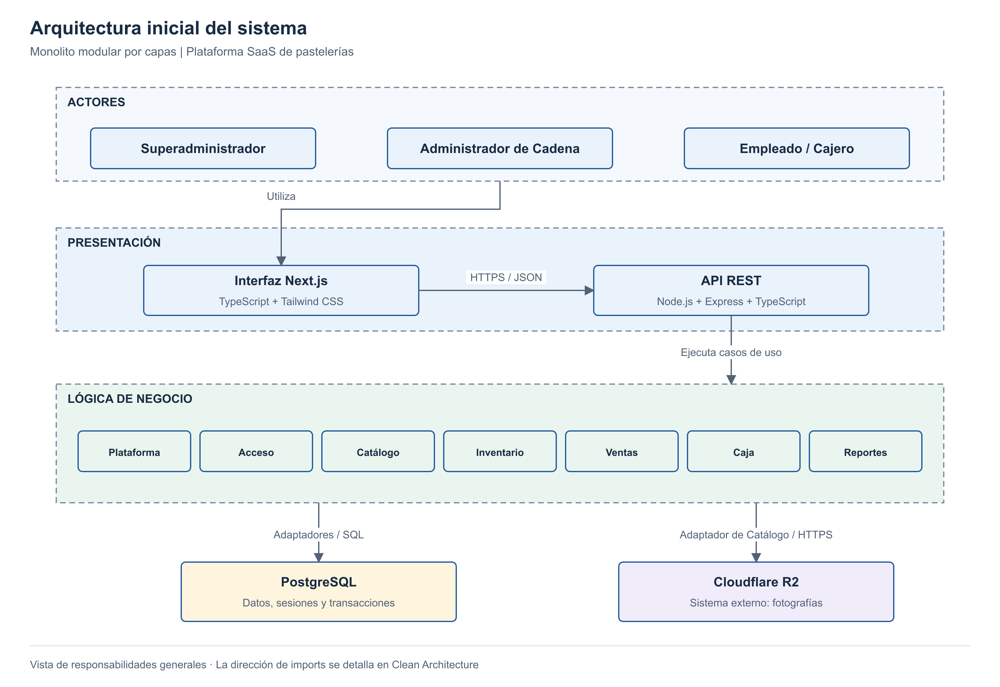

# Sweetly · Gestión inteligente para pastelerías

**Autor:** Rudy Gomez Bellido · **Curso:** Arquitectura de Software

Plataforma SaaS, web y móvil (PWA), para administrar una pastelería o una cadena de sucursales, con información separada por negocio.

## Problemática

En una pastelería, la operación diaria incluye recibir productos, vender, controlar existencias y administrar el efectivo de caja. Cuando estos registros se llevan en cuadernos, hojas de cálculo o de forma separada:

- El dueño no puede saber con certeza cuánto se vendió, cuánto se recaudó y cuánto se retiró en un periodo y sucursal.
- Una venta puede registrarse sin descontar el stock o sin reflejarse en caja, y luego es difícil explicar la diferencia.
- Las mermas, los vencimientos y los traslados entre sucursales no quedan registrados con responsable y motivo.
- No se identifica qué empleado realizó cada operación ni en qué turno.

**Propuesta:** una plataforma SaaS que centraliza y automatiza la gestión interna (personal, catálogo, inventario, ventas, caja y reportes) para uno o varios negocios, manteniendo separada la información de cada uno.

## Alcance

- Personal, permisos y turnos de trabajo.
- Productos, fotografías, inventario por lotes y vencimientos.
- Recepciones, traslados, mermas y fraccionamiento de tortas.
- Ventas presenciales, anulaciones, caja y entregas de efectivo.
- Reportes, historial y exportación a Excel.
- Un responsable de registro de ventas por sucursal a la vez.

**Fuera de la primera versión:** tienda pública, encargos, producción, reparto, contabilidad y facturación electrónica.

## Usuarios

| Usuario | Responsabilidad |
|---|---|
| Superadministrador | Administrar negocios y cuentas del servicio SaaS. |
| Administrador de Cadena | Gestionar su negocio, personal y sucursales; incluye al dueño de un solo local. |
| Empleado / Cajero | Registrar operaciones de su sucursal según turno y permisos. |

## Arquitectura y tecnología

| Elemento | Decisión |
|---|---|
| Estilo | Monolito modular por capas. |
| Enfoque interno | Clean Architecture en el backend. |
| Interfaz | Next.js, TypeScript y Tailwind CSS; vista de escritorio y PWA para celular. |
| API REST | Node.js, Express y TypeScript. |
| Persistencia | PostgreSQL y Prisma. |
| Fotografías | Cloudflare R2. |
| Despliegue previsto | Azure Static Web Apps (interfaz), Azure Container Apps (API) y Azure Database for PostgreSQL. |
| Metodología | Spec-Driven Development (SDD): especificación → plan → tareas → código. |



## Módulos

| Módulo | Responsabilidad | Requisitos |
|---|---|---|
| Plataforma | Negocios y sucursales | RF01–RF02 |
| Acceso | Personal, permisos, turnos y sesiones | RF03, RF16 |
| Catálogo | Productos, precios e imágenes | RF04 |
| Inventario | Stock, lotes, movimientos y porciones | RF05–RF07, RF14, RF18 |
| Ventas | Punto de venta, confirmación y anulación | RF09–RF10, RF15 |
| Caja | Apertura, cierre y entregas de efectivo | RF08, RF11–RF12 |
| Reportes | Consultas, historial y Excel | RF13, RF17 |

## Estructura del repositorio

```text
Pasteleria-arquitSoft-02-Rudy/
├── docs/                    Análisis, arquitectura, diseño y modelo C4
├── img/                     Diagramas
└── tecnologia/
    └── README.md            Tecnologías, diseño de interfaz y despliegue
```

## Despliegue

| Parte | Servicio | Dirección prevista |
|---|---|---|
| Interfaz web y PWA | Azure Static Web Apps | `app.sweetly.pe` |
| API REST | Azure Container Apps (Docker) | `api.sweetly.pe` |
| Base de datos | Azure Database for PostgreSQL (flexible) | Red privada |
| Fotografías | Cloudflare R2 | Acceso autorizado desde la API |
| Monitoreo | UptimeRobot sobre `/health` | — |

Detalle técnico y ejecución local en [tecnologia/README.md](tecnologia/README.md).

## Documentación

| Sección | Contenido |
|---|---|
| [Análisis del sistema](docs/01-analisis-de-sistema/01-actores.md) | Actores, historias, requisitos y calidad. |
| [Arquitectura](docs/02-arquitectura-software/arquitectura-inicial.md) | Estilo, enfoque y componentes. |
| [Diseño interno](docs/03-diseño-de-software/diseño-interno/diseño-interno-de-modulos.md) | Clases, secuencia y ejemplos TypeScript. |
| [Patrones](docs/03-diseño-de-software/diseño-interno/patrones-de-diseño.md) | Repository, Unit of Work y Adapter. |
| [SOLID](docs/03-diseño-de-software/diseño-interno/principios-de-diseño.md) | Aplicación de los cinco principios. |
| [Modelo C4](docs/04-modelo-c4/Nivel1-DiagramadeContextodelSistema.md) | Contexto, contenedores, componentes y código. |
| [Tecnologías](tecnologia/README.md) | Selección técnica, diseño de interfaz, ejecución y despliegue. |

## Reglas centrales

- Un negocio puede tener varias sucursales; sus datos permanecen aislados.
- Venta, descuento de stock y cobro se confirman en una sola transacción.
- Repetir una confirmación no duplica la venta.
- Se requiere conexión para confirmar operaciones.

**Estado (Sprint 01):** Plataforma, Acceso, Catálogo e Inventario se implementan en un proyecto de código aparte (`Sweetly`); Ventas, Caja y Reportes en los siguientes sprints.
