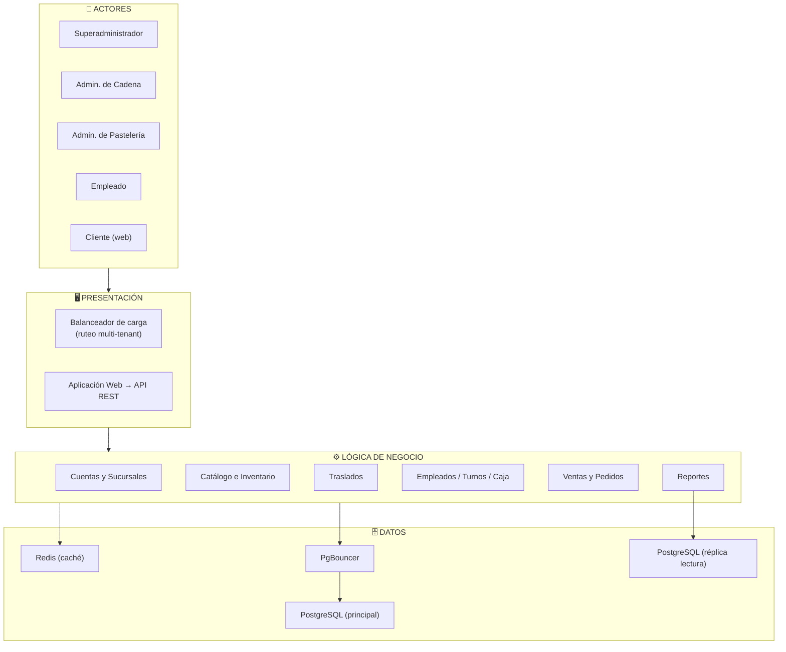

# 🏗️ Arquitectura Inicial del Sistema

## Descripción general
La arquitectura se organiza en **tres capas principales**, con
escalamiento horizontal en la capa de aplicación:

| Capa | Pregunta que responde |
|---|---|
| **Presentación** | ¿Cómo interactúa el usuario? |
| **Lógica de negocio** | ¿Qué hace el sistema? |
| **Datos** | ¿Dónde se almacena la información? |

El balanceador de carga resuelve además el ruteo multi-tenant por
sub-ruta. Se incorpora una capa de caché (Redis) para consultas de
stock/catálogo, un pool de conexiones (PgBouncer) y una réplica de
lectura para aislar la carga de reportes.

---

## Diagrama de arquitectura

---

## Justificación
La separación en capas aísla responsabilidades: presentación gestiona la
interacción multi-tenant por sub-ruta, la lógica de negocio concentra las
reglas de los 5 módulos funcionales, y la capa de datos combina caché
(rendimiento), pool de conexiones (estabilidad bajo carga) y réplica de
lectura (aislar reportes). Esta organización responde directamente a los
drivers de **concurrencia** (DA01), **rendimiento** (DA02) y
**escalabilidad** (DA03).