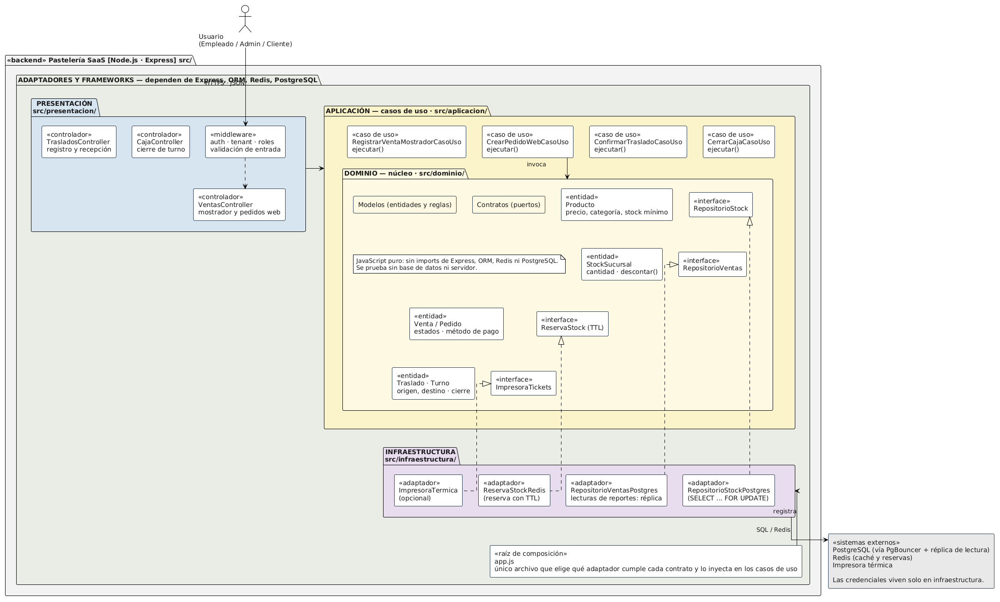

# 🧩 Patrones / Enfoque Arquitectónico

## Objetivo
Definir cómo se organizan las responsabilidades y las dependencias internas
del sistema, aplicando Clean Architecture (Arquitectura Limpia) dentro del
monolito modular de la plataforma SaaS de pastelerías.

---

## Enfoque seleccionado: Clean Architecture

| Elemento | Descripción aplicada a la plataforma de pastelerías |
|---|---|
| **Patrón / enfoque arquitectónico** | Clean Architecture (Arquitectura Limpia). |
| **Objetivo** | Separar responsabilidades y controlar las dependencias hacia el dominio. |
| **¿Qué problema resuelve?** | Evita el acoplamiento entre las reglas del negocio (descuento de stock, cierre de caja, traslados) y las tecnologías externas: Express, el ORM, PostgreSQL, Redis y la impresora de tickets. |
| **Capas definidas** | Presentación, Aplicación, Dominio e Infraestructura. |
| **Beneficios** | • Facilita el mantenimiento y las pruebas unitarias. • Permite cambiar implementaciones técnicas (por ejemplo, la impresora o el sistema de caché) sin modificar las reglas del negocio. • Mejora la organización y separación de responsabilidades del código. |

---

## Mapeo de capas (Clean Architecture → carpetas del proyecto)

| Capa | Carpeta | ¿Qué contiene? | Ejemplo en pastelerías |
|---|---|---|---|
| **Dominio** | `src/dominio/` | Entidades, objetos de valor, reglas de negocio y contratos (interfaces). No depende de Express, del ORM ni de Redis. | `Producto`, `StockSucursal`, `Venta`, `Traslado`, `Turno`, `RepositorioStock`, `ReservaStock` |
| **Aplicación** | `src/aplicacion/` | Casos de uso que orquestan el dominio. | `RegistrarVentaMostradorCasoUso`, `CrearPedidoWebCasoUso`, `ConfirmarTrasladoCasoUso`, `CerrarCajaCasoUso` |
| **Presentación** | `src/presentacion/` | Rutas, controladores y middlewares (autenticación, resolución de tenant, roles). | `VentasController`, `TrasladosController`, `CajaController` |
| **Infraestructura** | `src/infraestructura/` | Adaptadores concretos que implementan los contratos del dominio. | `RepositorioStockPostgres`, `ReservaStockRedis`, `ImpresoraTermica` |

---

## Regla de dependencia

1. El dominio no importa nada de las capas externas.
2. Los casos de uso solo conocen entidades y contratos (interfaces) del dominio.
3. Los adaptadores de infraestructura implementan esos contratos y son intercambiables.
4. Cambiar de tecnología equivale a cambiar `app.js` (la raíz de composición), no el dominio.

Las dependencias de código siempre apuntan hacia el centro (Dominio). Las
llamadas en tiempo de ejecución pueden ir hacia afuera gracias a la
inversión de dependencias.

---

## Cómo se aplica al punto crítico: descuento de stock

El descuento de stock es la regla más sensible del sistema (DA01), y por eso
vive en el dominio y en un caso de uso, no en el controlador ni en la consulta SQL:

1. `VentasController` recibe la solicitud (mostrador o web) y llama al caso de uso.
2. `RegistrarVentaMostradorCasoUso` o `CrearPedidoWebCasoUso` pide reservar el stock a través del contrato `ReservaStock`.
3. La entidad `StockSucursal` aplica la regla `descontar()`, que rechaza cantidades mayores al stock disponible.
4. El adaptador `RepositorioStockPostgres` confirma el descuento dentro de una transacción con `SELECT ... FOR UPDATE`.

El caso de uso no sabe si la reserva se guarda en Redis ni si el bloqueo lo
hace PostgreSQL: solo conoce los contratos.

---

## Diagrama de arquitectura (Clean Architecture)

---

## Relación con los drivers arquitectónicos

| Driver | Cómo lo resuelve Clean Architecture |
|---|---|
| **DA01 – Concurrencia** | La regla de descuento está en el dominio y el bloqueo transaccional queda aislado en un adaptador. |
| **DA02 – Rendimiento** | La caché Redis es un adaptador: se agrega o cambia sin tocar los casos de uso. |
| **DA05 / DA06 – PgBouncer y réplica** | Los adaptadores de repositorio eligen conexión principal o réplica; el dominio no lo sabe. |
| **DA07 – Mantenibilidad** | El dominio aislado permite cambiar un adaptador (impresora, caché, ORM) sin afectar las reglas ni otros módulos. |