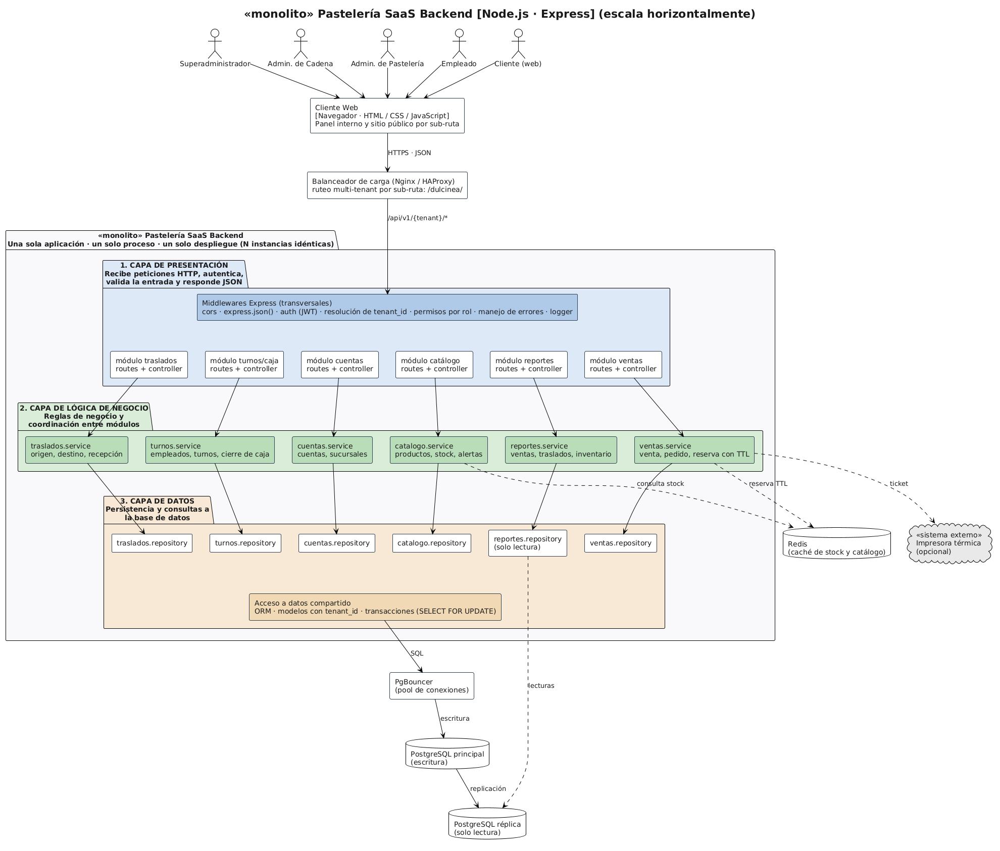

# 🏛️ Estilo Arquitectónico

## Objetivo
Definir la forma global de organización y despliegue de la plataforma SaaS
de gestión de pastelerías, respondiendo a los drivers arquitectónicos
identificados.

---

## Estilo seleccionado: Monolito Modular con Escalamiento Horizontal

| Aspecto | Descripción |
|---|---|
| **Unidad de despliegue** | Una sola aplicación backend (un solo proceso Node.js/Express por instancia) |
| **Organización interna** | Módulos independientes: Cuentas y Sucursales, Catálogo e Inventario, Traslados, Turnos/Caja, Ventas y Pedidos, Reportes |
| **Escalamiento** | Horizontal: se agregan instancias idénticas del monolito detrás de un balanceador de carga |
| **Multi-tenant** | Todas las cuentas comparten la misma infraestructura; el balanceador resuelve el tenant por sub-ruta y los datos se aíslan con `tenant_id` |
| **Comunicación entre módulos** | Interna, llamando al service de cada módulo (no hay red entre módulos) |
| **Datos** | PostgreSQL con PgBouncer (pool de conexiones), Redis (caché) y una réplica de lectura para reportes |

## ¿Por qué este estilo y no otro?

| Alternativa | Por qué NO se eligió |
|---|---|
| **Microservicios** | El descuento de stock debe ser una única transacción atómica (DA01). Separar Catálogo, Ventas y Caja en servicios con bases propias obligaría a coordinar transacciones distribuidas. |
| **Monolito sin modularidad** | Dificulta modificar un módulo sin afectar otros, contra el driver DA07 (Mantenibilidad). |
| **Serverless** | El control de concurrencia con bloqueo de filas y reservas TTL necesita conexiones persistentes a la base de datos, que no encajan con funciones efímeras. |

**Decisión:** monolito modular. Un único despliegue, organizado en módulos por capas, que escala agregando instancias completas detrás del balanceador y mantiene la consistencia del stock en una sola transacción.

---

## Relación con los drivers

| Driver | Cómo lo responde este estilo |
|---|---|
| **DA01** Concurrencia | La transacción de stock vive en un solo proceso y una sola base de datos |
| **DA02** Rendimiento | Redis responde las consultas de stock y catálogo |
| **DA03** Escalabilidad | Más instancias detrás del balanceador, sin rediseñar |
| **DA04** Multi-tenant | `tenant_id` en el modelo de datos y resolución de tenant en el middleware |
| **DA05** Pool de conexiones | PgBouncer entre la aplicación y PostgreSQL |
| **DA06** Reportes | `reportes.repository` lee desde la réplica |
| **DA07** Mantenibilidad | Módulos con sus propias capas y comunicación solo vía service |

---

## Diagrama de arquitectura

---

## Reglas de la arquitectura
1. Cada capa solo invoca a la capa inmediatamente inferior.
2. Un módulo no accede al repository ni a las tablas de otro módulo.
3. La comunicación entre módulos se hace llamando a su service.
4. Todo se ejecuta en un único proceso Node.js por instancia, con una única base de datos principal.
5. Toda consulta filtra por `tenant_id`.