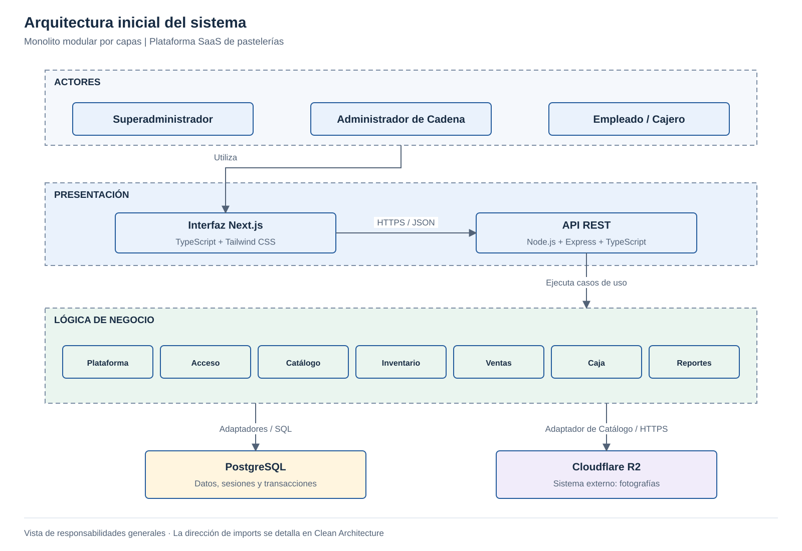

# Arquitectura inicial del sistema

## Diagrama de arquitectura

## Descripción

La plataforma adopta un **monolito modular por capas**. El backend tiene una única unidad de despliegue y siete módulos con responsabilidades delimitadas.

- **Presentación:** Next.js, TypeScript y Tailwind CSS ofrecen la interfaz interna; las rutas y controladores Express reciben solicitudes mediante API REST.
- **Lógica de negocio:** Plataforma, Acceso, Catálogo, Inventario, Ventas, Caja y Reportes coordinan la gestión de cada negocio y sus sucursales.
- **Datos:** los adaptadores Prisma y SQL parametrizado acceden a PostgreSQL, donde se conservan los registros transaccionales y las sesiones.
- **Sistema externo:** Cloudflare R2 almacena fotografías mediante el adaptador de Catálogo.

La venta, el cobro y el descuento de stock comparten una transacción. El negocio es el tenant; sus sucursales no son tenants separados. La interfaz compilada se sirve junto a la API bajo el mismo origen; no se duplican reglas de negocio en Next.js.
