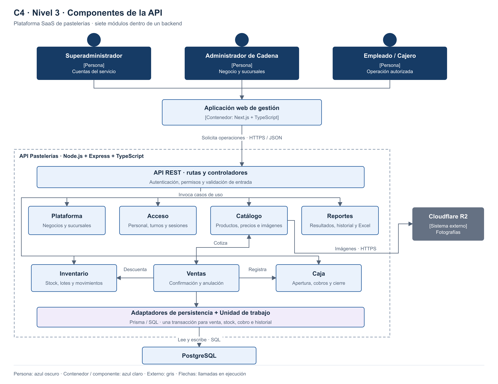

# Componentes arquitectónicos

| Capa interna | Responsabilidad |
|---|---|
| Presentación | Recibir solicitudes, validar formato y responder con resultados comprensibles. |
| Aplicación | Coordinar autorización, ventas, inventario y caja mediante casos de uso. |
| Dominio | Validar cantidades, importes y transiciones de estado. |
| Infraestructura | Implementar transacciones, persistencia, sesiones e imágenes. |

- Los usuarios acceden mediante la **aplicación web de gestión**.
- Acceso valida sesión, negocio, sucursal y permisos.
- PostgreSQL refuerza el aislamiento por negocio mediante RLS y claves compuestas.