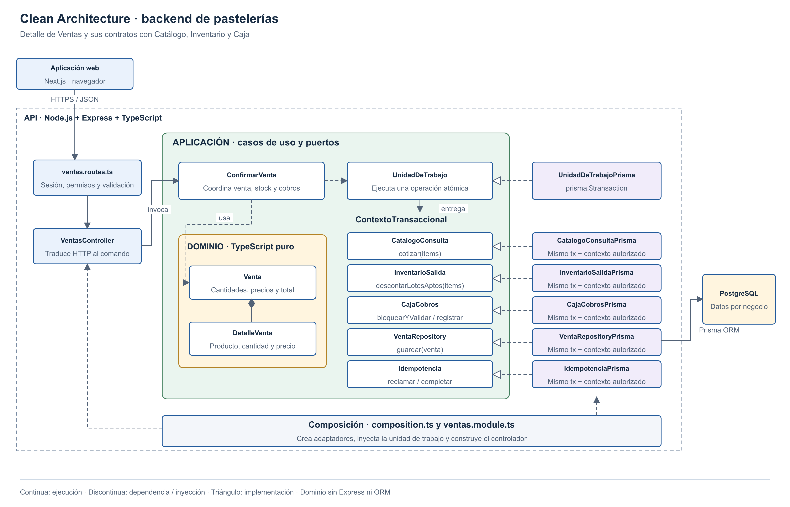

# Enfoque arquitectónico

**Clean Architecture dentro del backend del monolito modular.**

| Parte | Elementos del proyecto | Responsabilidad |
|---|---|---|
| Presentación | Rutas, validación y `VentasController` | Traducir HTTP a una operación autorizada. |
| Aplicación | `ConfirmarVenta`, contratos y `UnidadDeTrabajo` | Coordinar venta, stock y cobros. |
| Dominio | `Venta`, `DetalleVenta` | Validar cantidades, precios y total. |
| Infraestructura | Adaptadores de módulos y Prisma ORM | Implementar contratos y persistir en PostgreSQL. |
| Composición | `composition.ts`, `ventas.module.ts` | Crear adaptadores e inyectarlos en los casos de uso. |

- El dominio no importa Express, Prisma ni proveedores.
- Los puertos están en Aplicación porque expresan necesidades de los casos de uso.
- La anidación representa niveles de dependencia; las carpetas son hermanas.
- El mismo esquema se aplica a los demás módulos; Ventas muestra una colaboración completa.
