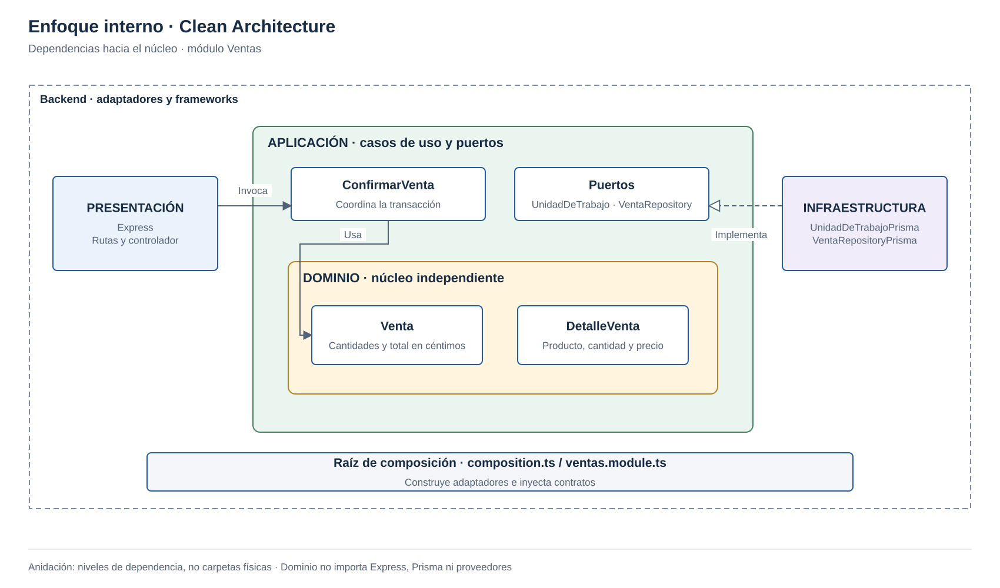

Se utiliza el enfoque **Clean Architecture** para separar las reglas del negocio de la tecnología.

| Elemento | Descripción aplicada a la plataforma de pastelerías |
|---|---|
| Patrón / enfoque arquitectónico | Clean Architecture (Arquitectura Limpia). |
| Objetivo | Separar responsabilidades y dirigir las dependencias hacia el núcleo del negocio. |
| ¿Qué problema resuelve? | Evita que las reglas de ventas, inventario y caja dependan de Next.js, Express, Prisma o el almacenamiento de imágenes. |
| Capas definidas | Presentación, Aplicación, Dominio e Infraestructura. |
| Beneficios | Facilita pruebas de reglas, delimita cambios y permite sustituir adaptadores sin modificar innecesariamente el dominio. |

- El dominio ocupa el centro; Aplicación coordina sus reglas.
- Los recuadros anidados representan niveles de dependencia, no carpetas contenidas físicamente.
- Infraestructura implementa los puertos de Aplicación; composición conecta las implementaciones.
