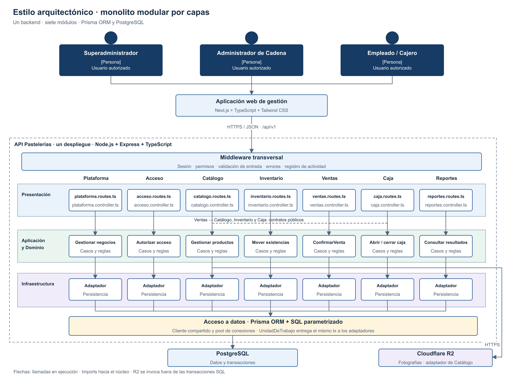

# Estilo arquitectónico

Se utiliza **monolito modular por capas**, con una API REST Node.js + Express y una base PostgreSQL compartida con aislamiento por negocio.

| Elemento | Aplicación al sistema |
|---|---|
| Unidad de despliegue | Los siete módulos de backend se construyen y despliegan juntos. |
| Modularidad | Cada módulo es dueño de sus reglas y escrituras; expone contratos explícitos. |
| Capas | Presentación HTTP, casos de uso, dominio y adaptadores técnicos. |
| Comunicación | Llamadas internas; no HTTP entre módulos del mismo proceso. |
| Acceso a datos | Prisma ORM y SQL parametrizado, utilizados por adaptadores de cada módulo. |
| Consistencia | Venta, stock y caja comparten conexión y transacción mediante Unit of Work. |
| Escalamiento inicial | Optimizar índices, paginación y recursos; después ampliar instancias si las mediciones lo justifican. |
| Costo | Un cambio exige desplegar el backend completo. Los límites modulares requieren revisiones y pruebas. |
