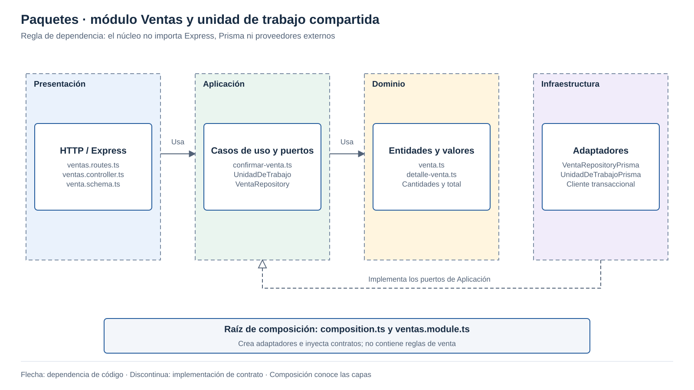

# Diseño interno de módulos

> **Proyecto:** Plataforma SaaS de pastelerías · **Backend:** Node.js + Express + TypeScript  
> **Módulo de referencia:** Ventas · **Diseño:** monolito modular con Clean Architecture.

## 1. Propósito

- Confirmar una venta junto con su stock y cobro.
- Coordinar Catálogo, Inventario y Caja mediante contratos.

## 2. Estructura prevista del proyecto

```text
tecnologia/pasteleria-saas/
├── apps/
│   ├── web/                         Next.js + TypeScript + Tailwind CSS
│   │   ├── src/app/                 Rutas: acceso, plataforma, administración, caja
│   │   ├── src/features/            Catálogo, inventario, ventas, caja y reportes
│   │   ├── src/components/          Formularios, tablas y componentes compartidos
│   │   ├── src/lib/api/             Cliente HTTP, sesión y errores
│   │   └── next.config.ts           Exportación estática; sin backend de negocio
│   └── api/
│       ├── src/app.ts               Middleware y rutas Express
│       ├── src/server.ts            Arranque, salud y cierre de conexiones
│       ├── src/composition.ts       Ensambla módulos y transacciones
│       ├── src/shared/              Contexto autorizado, errores y transacciones
│       └── src/modules/
│           ├── plataforma/         Negocios, límites y sucursales
│           ├── acceso/             Usuarios, permisos, turnos y sesiones
│           ├── catalogo/           Productos, precios y fotografías
│           ├── inventario/         Lotes, vencimientos, movimientos y traslados
│           ├── ventas/             Confirmación y anulación
│           ├── caja/               Sesiones, cobros, cierres y entregas
│           └── reportes/           Consultas, historial y exportación XLSX
├── database/                       Esquema Prisma, migraciones SQL/RLS y semillas
├── tests/                          Integración, aislamiento, navegador y carga
└── compose.yaml                    PostgreSQL local para desarrollo
```

- Contratos públicos por módulo en `index.ts`.
- Reportes lee proyecciones; no modifica datos operativos.

### Módulo Ventas

```text
apps/api/src/modules/ventas/
├── dominio/
│   ├── venta.ts
│   └── detalle-venta.ts
├── aplicacion/
│   ├── confirmar-venta.ts
│   ├── confirmar-venta.command.ts
│   ├── anular-venta.ts
│   └── venta-repository.ts
├── infraestructura/
│   └── venta-repository-prisma.ts
├── presentacion/
│   ├── ventas.routes.ts
│   ├── ventas.controller.ts
│   └── venta.schema.ts
├── ventas.module.ts
└── index.ts

apps/api/src/shared/transacciones/
├── unidad-de-trabajo.ts             Contrato del núcleo de aplicación
├── contexto-transaccional.ts        Agrupa puertos pequeños, no métodos globales
└── unidad-de-trabajo-prisma.ts      Adaptador que conecta a todos al mismo tx
```

## 3. Capas y dependencias



| Capa | Archivos representativos | Responsabilidad | Dependencias permitidas |
|---|---|---|---|
| Dominio | `venta.ts`, `detalle-venta.ts` | Validar cantidades, precios y total en céntimos. | TypeScript puro y tipos del dominio. |
| Aplicación | `confirmar-venta.ts`, `anular-venta.ts` | Coordinar reglas y puertos de los módulos participantes. | Dominio y contratos de aplicación; sin Express ni Prisma. |
| Infraestructura | `venta-repository-prisma.ts` | Persistir venta y detalle con el cliente transaccional recibido. | Contratos, dominio y Prisma/SQL. |
| Presentación | `ventas.routes.ts`, `ventas.controller.ts`, `venta.schema.ts` | Validar entrada HTTP, llamar al caso de uso y traducir errores. | Express, validación y aplicación; sin SQL directo. |
| Composición | `ventas.module.ts`, `composition.ts` | Elegir adaptadores e inyectarlos por constructor. | Todas las capas, únicamente para ensamblarlas. |

- Aplicación define los puertos que necesita.
- Dominio contiene las reglas sin dependencias tecnológicas.

## 4. Clases y contratos


- `ContextoTransaccional` reúne cinco puertos separados.
- Todos los adaptadores comparten la misma transacción.

## 5. Flujo de confirmación


1. Express autentica, autoriza negocio/sucursal y valida la estructura del comando.
2. El caso de uso inicia la unidad de trabajo y reclama una clave idempotente ligada al negocio, usuario y contenido.
3. Caja bloquea su sesión y comprueba que esté abierta y pertenezca al empleado; Catálogo entrega precios del servidor.
4. Ventas construye la entidad; Inventario selecciona lotes aptos, bloquea en orden estable y descuenta solo si hay saldo suficiente.
5. Los adaptadores guardan venta, cobros, movimientos y resultado idempotente. PostgreSQL confirma todo o revierte todo.
6. Se devuelve el resultado después del commit. Un reintento idéntico recupera el resultado anterior.

- Cierre de caja y venta validan la misma sesión.
- R2 y Excel se ejecutan fuera de la transacción de venta.

## 6. Código de referencia

Fragmentos del diseño de Ventas. Se omiten imports y DTO completos; los importes se expresan en céntimos.

### Dominio · `detalle-venta.ts`

```ts
type DetalleVenta = Readonly<{
  productoId: string;
  cantidad: number;
  precioCentimos: number;
}>;
```

### Dominio · `venta.ts`

```ts
class Venta {
  readonly detalles: readonly DetalleVenta[];

  constructor(detalles: readonly DetalleVenta[]) {
    if (detalles.length === 0) {
      throw new Error('VENTA_VACIA');
    }

    for (const detalle of detalles) {
      if (
        !detalle.productoId ||
        !Number.isSafeInteger(detalle.cantidad) ||
        detalle.cantidad <= 0
      ) {
        throw new Error('CANTIDAD_INVALIDA');
      }

      if (
        !Number.isSafeInteger(detalle.precioCentimos) ||
        detalle.precioCentimos < 0
      ) {
        throw new Error('PRECIO_INVALIDO');
      }
    }

    this.detalles = Object.freeze(
      detalles.map((detalle) => Object.freeze({ ...detalle }))
    );

    if (!Number.isSafeInteger(this.totalCentimos())) {
      throw new Error('TOTAL_FUERA_DE_RANGO');
    }
  }

  totalCentimos(): number {
    return this.detalles.reduce(
      (suma, detalle) => suma + detalle.cantidad * detalle.precioCentimos,
      0
    );
  }
}
```

### Aplicación · `confirmar-venta.command.ts`

```ts
type Item = Readonly<{
  productoId: string;
  cantidad: number;
}>;

type Cobro = Readonly<{
  medio: 'EFECTIVO' | 'TARJETA' | 'BILLETERA';
  aplicadoCentimos: number;
}>;

type Comando = Readonly<{
  clave: string;
  sesionCajaId: string;
  items: readonly Item[];
  cobros: readonly Cobro[];
}>;

type Resultado = Readonly<{
  ventaId: string;
  totalCentimos: number;
}>;
```

### Aplicación · puertos de colaboración

Cada interfaz se define en su archivo y se expone mediante el contrato público de su módulo.

```ts
// catalogo-consulta.ts
interface CatalogoConsulta {
  cotizar(items: readonly Item[]): Promise<readonly DetalleVenta[]>;
}

// inventario-salida.ts
interface InventarioSalida {
  descontarLotesAptos(items: readonly Item[]): Promise<void>;
}

// caja-cobros.ts
interface CajaCobros {
  bloquearYValidar(sesionId: string): Promise<void>;
  registrar(ventaId: string, cobros: readonly Cobro[]): Promise<void>;
}

// venta-repository.ts
interface VentaRepository {
  guardar(venta: Venta): Promise<string>;
}

// idempotencia.ts
interface Idempotencia {
  reclamar(cmd: Comando): Promise<Resultado | null>;
  completar(clave: string, resultado: Resultado): Promise<void>;
}
```

### Aplicación compartida · `contexto-transaccional.ts`

```ts
type ContextoAutorizado = Readonly<{
  tenantId: string;
  sucursalId: string;
  usuarioId: string;
}>;

interface ContextoTransaccional {
  catalogo: CatalogoConsulta;
  inventario: InventarioSalida;
  caja: CajaCobros;
  ventas: VentaRepository;
  idempotencia: Idempotencia;
}
```

### Aplicación compartida · `unidad-de-trabajo.ts`

```ts
interface UnidadDeTrabajo {
  ejecutar<T>(
    ctx: ContextoAutorizado,
    operacion: (tx: ContextoTransaccional) => Promise<T>
  ): Promise<T>;
}
```

### Aplicación · `confirmar-venta.ts`

```ts
class ConfirmarVenta {
  constructor(private readonly uow: UnidadDeTrabajo) {}

  ejecutar(cmd: Comando, ctx: ContextoAutorizado): Promise<Resultado> {
    return this.uow.ejecutar(ctx, async (tx) => {
      const anterior = await tx.idempotencia.reclamar(cmd);

      if (anterior) {
        return anterior;
      }

      await tx.caja.bloquearYValidar(cmd.sesionCajaId);
      const detalles = await tx.catalogo.cotizar(cmd.items);
      const venta = new Venta(detalles);

      const cobroInvalido = cmd.cobros.some(
        (cobro) =>
          !Number.isSafeInteger(cobro.aplicadoCentimos) ||
          cobro.aplicadoCentimos < 0
      );

      if (cmd.cobros.length === 0 || cobroInvalido) {
        throw new Error('COBRO_INVALIDO');
      }

      const aplicado = cmd.cobros.reduce(
        (suma, cobro) => suma + cobro.aplicadoCentimos,
        0
      );

      if (
        !Number.isSafeInteger(aplicado) ||
        aplicado !== venta.totalCentimos()
      ) {
        throw new Error('COBRO_NO_COINCIDE');
      }

      await tx.inventario.descontarLotesAptos(cmd.items);
      const ventaId = await tx.ventas.guardar(venta);
      await tx.caja.registrar(ventaId, cmd.cobros);

      const resultado: Resultado = {
        ventaId,
        totalCentimos: venta.totalCentimos()
      };

      await tx.idempotencia.completar(cmd.clave, resultado);
      return resultado;
    });
  }
}
```

### Infraestructura · contratos de implementación

| Archivo | Responsabilidad |
|---|---|
| `unidad-de-trabajo-prisma.ts` | Abrir `prisma.$transaction`, establecer tenant con SQL parametrizado y entregar el mismo `tx` a los adaptadores. |
| `venta-repository-prisma.ts` | Guardar cabecera y detalles con precios históricos, dentro de ese `tx`. |
| Adaptadores de Catálogo, Inventario y Caja | Cotizar con precios del servidor; descontar lotes aptos; guardar cobros y movimientos. |
| Adaptador de Idempotencia | Clave única por negocio, usuario y operación; comparar la huella del comando completo. |

### Presentación · `ventas.controller.ts`

Fragmento posterior a autenticación, autorización y validación de entrada.

```ts
class VentasController {
  constructor(private readonly confirmarVenta: ConfirmarVenta) {}

  confirmar = async (req: Request, res: Response): Promise<void> => {
    const { comando, contextoAutorizado } = res.locals;
    const resultado = await this.confirmarVenta.ejecutar(
      comando,
      contextoAutorizado
    );

    res.status(201).json(resultado);
  };
}
```

### Composición · `ventas.module.ts`

```ts
function crearModuloVentas(uow: UnidadDeTrabajo) {
  const confirmarVenta = new ConfirmarVenta(uow);
  const controller = new VentasController(confirmarVenta);

  return { controller };
}
```

| Punto de entrada | Responsabilidad |
|---|---|
| `ventas.routes.ts` | Enlazar `POST /api/v1/ventas` con autenticación, permisos, validación y controlador. |
| `composition.ts` | Construir `UnidadDeTrabajoPrisma` y entregarla a `crearModuloVentas`. |
| Middleware de errores | Traducir conflictos a 409; sesión ausente a 401 y permisos insuficientes a 403. |

## 7. Condiciones que se verifican

- Contexto autorizado obtenido de la sesión; nunca del cuerpo de la petición.
- Un responsable de registro por sucursal; ventas simultáneas entre sucursales o negocios.
- Sin stock negativo, lotes vencidos, cobros duplicados ni commits parciales.
- Auditoría y movimientos forman parte de la misma transacción.
- Efectivo recibido y vuelto: detalle funcional definido en RF10.
- Pruebas con PostgreSQL: aislamiento, reintentos, rollback y cierre frente a venta.
