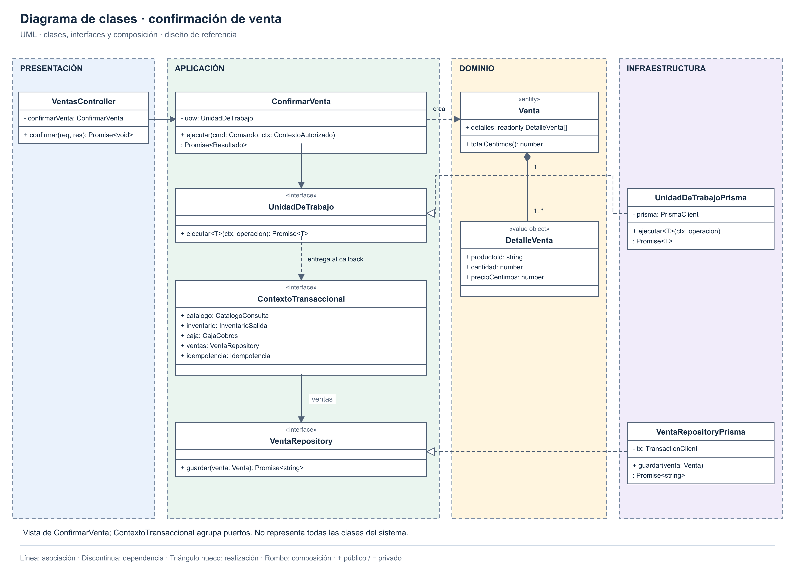
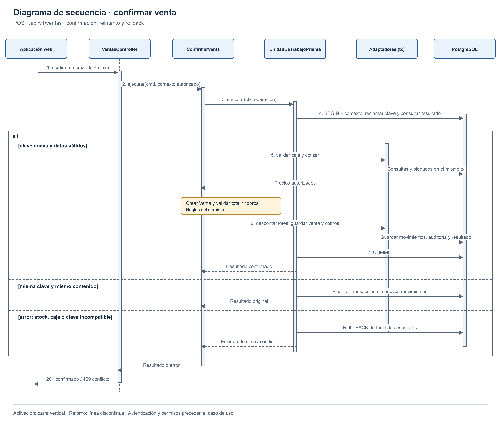

# Diseño interno de módulos

> **Proyecto:** Plataforma SaaS de pastelerías · **Backend:** Node.js + Express + TypeScript  
> **Módulo de referencia:** Ventas · **Diseño:** monolito modular con Clean Architecture.

## 1. Propósito

- Confirmar una venta junto con su stock y cobro.
- Coordinar Catálogo, Inventario y Caja mediante contratos.

## 2. Estructura de carpetas

**Un solo proyecto:** `tecnologia/pasteleria-saas/` contiene `apps/web/` (interfaz), `apps/api/` (backend) y `database/` (Prisma y migraciones).

**Detalle del módulo Ventas dentro de ese backend:**

```text
apps/api/src/modules/ventas/
├── dominio/
│   ├── venta.ts
│   └── detalle-venta.ts
├── aplicacion/
│   ├── confirmar-venta.ts
│   ├── confirmar-venta.command.ts
│   ├── anular-venta.ts
│   └── venta-repository.ts
├── infraestructura/
│   └── venta-repository-prisma.ts
├── presentacion/
│   ├── ventas.routes.ts
│   ├── ventas.controller.ts
│   └── venta.schema.ts
├── ventas.module.ts
└── index.ts

apps/api/src/shared/transacciones/
├── unidad-de-trabajo.ts             Contrato del núcleo de aplicación
├── contexto-transaccional.ts        Agrupa puertos pequeños, no métodos globales
└── unidad-de-trabajo-prisma.ts      Adaptador que conecta a todos al mismo tx
```

## 3. Capas y dependencias


| Capa | Archivos representativos | Responsabilidad | Dependencias permitidas |
|---|---|---|---|
| Dominio | `venta.ts`, `detalle-venta.ts` | Validar cantidades, precios y total en céntimos. | TypeScript puro y tipos del dominio. |
| Aplicación | `confirmar-venta.ts`, `anular-venta.ts` | Coordinar reglas y puertos de los módulos participantes. | Dominio y contratos de aplicación; sin Express ni Prisma. |
| Infraestructura | `venta-repository-prisma.ts` | Persistir venta y detalle con el cliente transaccional recibido. | Contratos, dominio y Prisma/SQL. |
| Presentación | `ventas.routes.ts`, `ventas.controller.ts`, `venta.schema.ts` | Validar entrada HTTP, llamar al caso de uso y traducir errores. | Express, validación y aplicación; sin SQL directo. |
| Composición | `ventas.module.ts`, `composition.ts` | Elegir adaptadores e inyectarlos por constructor. | Todas las capas, únicamente para ensamblarlas. |

- Aplicación define los puertos que necesita.
- Dominio contiene las reglas sin dependencias tecnológicas.

## 4. Clases y contratos



- `ContextoTransaccional` reúne cinco puertos separados.
- Todos los adaptadores comparten la misma transacción.

## 5. Flujo de confirmación



| Paso | Operación |
|---|---|
| 1 | Validar sesión, permisos y comando. |
| 2 | Abrir transacción y comprobar la clave de reintento. |
| 3 | Validar caja y obtener precios del servidor. |
| 4 | Validar venta y descontar lotes aptos. |
| 5 | Guardar venta, cobros, movimientos e historial. |
| 6 | Confirmar todo o revertir; responder después del commit. |

## 6. Código de referencia en TypeScript

Ejemplo acotado de Ventas: clases para el comportamiento, interfaces para los contratos y `type` para los datos. Se omiten imports, DTO HTTP y adaptadores auxiliares; no es una implementación completa. Infraestructura usa la API de Prisma Client 7.

### 6.1 Dominio · entidad y reglas

```ts
// dominio/venta.ts
class Venta {
  readonly detalles: readonly DetalleVenta[];

  constructor(detalles: readonly DetalleVenta[]) {
    if (detalles.length === 0) {
      throw new Error('VENTA_VACIA');
    }

    for (const detalle of detalles) {
      if (
        !detalle.productoId ||
        !Number.isSafeInteger(detalle.cantidad) ||
        detalle.cantidad <= 0
      ) {
        throw new Error('CANTIDAD_INVALIDA');
      }

      if (
        !Number.isSafeInteger(detalle.precioCentimos) ||
        detalle.precioCentimos < 0
      ) {
        throw new Error('PRECIO_INVALIDO');
      }
    }

    this.detalles = Object.freeze(
      detalles.map((detalle) => Object.freeze({ ...detalle }))
    );

    if (!Number.isSafeInteger(this.totalCentimos())) {
      throw new Error('TOTAL_FUERA_DE_RANGO');
    }
  }

  totalCentimos(): number {
    return this.detalles.reduce(
      (suma, detalle) => suma + detalle.cantidad * detalle.precioCentimos,
      0
    );
  }
}

// dominio/detalle-venta.ts: valor inmutable utilizado por Venta.
type DetalleVenta = Readonly<{
  productoId: string;
  cantidad: number;
  precioCentimos: number;
}>;
```

### 6.2 Aplicación · contratos y datos

Los puertos pertenecen a Aplicación y cada adaptador respeta el negocio y la sucursal del contexto autenticado.

```ts
// DTO de entrada y resultado; no contienen reglas de negocio.
type Item = Readonly<{
  productoId: string; cantidad: number;
}>;

type Cobro = Readonly<{
  medio: 'EFECTIVO' | 'TARJETA' | 'BILLETERA'; aplicadoCentimos: number;
}>;

type Comando = Readonly<{
  clave: string; sesionCajaId: string; items: readonly Item[]; cobros: readonly Cobro[];
}>;

type Resultado = Readonly<{
  ventaId: string; totalCentimos: number;
}>;

// catalogo-consulta.ts
interface CatalogoConsulta {
  cotizar(items: readonly Item[]): Promise<readonly DetalleVenta[]>;
}

// inventario-salida.ts
interface InventarioSalida {
  descontarLotesAptos(items: readonly Item[]): Promise<void>;
}

// caja-cobros.ts
interface CajaCobros {
  bloquearYValidar(sesionId: string): Promise<void>;
  registrar(ventaId: string, cobros: readonly Cobro[]): Promise<void>;
}

// venta-repository.ts
interface VentaRepository {
  guardar(venta: Venta): Promise<string>;
}

// idempotencia.ts
interface Idempotencia {
  reclamar(cmd: Comando): Promise<Resultado | null>;
  completar(clave: string, resultado: Resultado): Promise<void>;
}

type ContextoAutorizado = Readonly<{
  tenantId: string; sucursalId: string; usuarioId: string;
}>;

interface ContextoTransaccional {
  catalogo: CatalogoConsulta;
  inventario: InventarioSalida;
  caja: CajaCobros;
  ventas: VentaRepository;
  idempotencia: Idempotencia;
}

interface UnidadDeTrabajo {
  ejecutar<T>(
    ctx: ContextoAutorizado,
    operacion: (tx: ContextoTransaccional) => Promise<T>
  ): Promise<T>;
}
```

### 6.3 Aplicación · confirmar la venta

```ts
// aplicacion/confirmar-venta.ts
class ConfirmarVenta {
  constructor(private readonly uow: UnidadDeTrabajo) {}

  ejecutar(cmd: Comando, ctx: ContextoAutorizado): Promise<Resultado> {
    return this.uow.ejecutar(ctx, async (tx) => {
      const anterior = await tx.idempotencia.reclamar(cmd);

      if (anterior) {
        return anterior;
      }

      await tx.caja.bloquearYValidar(cmd.sesionCajaId);
      const detalles = await tx.catalogo.cotizar(cmd.items);
      const venta = new Venta(detalles);

      const cobroInvalido = cmd.cobros.some(
        (cobro) =>
          !Number.isSafeInteger(cobro.aplicadoCentimos) ||
          cobro.aplicadoCentimos < 0
      );

      if (cmd.cobros.length === 0 || cobroInvalido) {
        throw new Error('COBRO_INVALIDO');
      }

      const aplicado = cmd.cobros.reduce(
        (suma, cobro) => suma + cobro.aplicadoCentimos,
        0
      );

      if (
        !Number.isSafeInteger(aplicado) ||
        aplicado !== venta.totalCentimos()
      ) {
        throw new Error('COBRO_NO_COINCIDE');
      }

      await tx.inventario.descontarLotesAptos(cmd.items);
      const ventaId = await tx.ventas.guardar(venta);
      await tx.caja.registrar(ventaId, cmd.cobros);

      const resultado: Resultado = {
        ventaId,
        totalCentimos: venta.totalCentimos()
      };

      await tx.idempotencia.completar(cmd.clave, resultado);
      return resultado;
    });
  }
}
```

### 6.4 Infraestructura y composición

**Unidad de trabajo:** todos los puertos reciben el mismo cliente transaccional.

```ts
// shared/transacciones/unidad-de-trabajo-prisma.ts
type CrearContexto = (
  tx: Prisma.TransactionClient,
  ctx: ContextoAutorizado
) => ContextoTransaccional;

class UnidadDeTrabajoPrisma implements UnidadDeTrabajo {
  constructor(
    private readonly prisma: PrismaClient,
    private readonly crearContexto: CrearContexto
  ) {}

  ejecutar<T>(
    ctx: ContextoAutorizado,
    operacion: (puertos: ContextoTransaccional) => Promise<T>
  ): Promise<T> {
    return this.prisma.$transaction(async (tx) => {
      // Contexto de sesión verificado; valor parametrizado y local al tx.
      await tx.$queryRaw`
        SELECT set_config('app.tenant_id', ${ctx.tenantId}, true)
      `;

      const puertos = this.crearContexto(tx, ctx);
      return operacion(puertos);
      // Prisma confirma al terminar; una excepción revierte la operación.
    });
  }
}
```

**Repositorio:** implementa el contrato; los campos corresponden al esquema previsto.

```ts
// Ejemplo de mapeo; los nombres de campos corresponden al esquema previsto.
class VentaRepositoryPrisma implements VentaRepository {
  constructor(
    private readonly tx: Prisma.TransactionClient,
    private readonly ctx: ContextoAutorizado
  ) {}

  async guardar(venta: Venta): Promise<string> {
    const registro = await this.tx.venta.create({
      data: {
        tenantId: this.ctx.tenantId,
        sucursalId: this.ctx.sucursalId,
        usuarioId: this.ctx.usuarioId,
        totalCentimos: venta.totalCentimos(),
        detalles: {
          create: venta.detalles.map((detalle) => ({
            tenantId: this.ctx.tenantId,
            productoId: detalle.productoId,
            cantidad: detalle.cantidad,
            precioCentimos: detalle.precioCentimos
          }))
        }
      }
    });

    return registro.id;
  }
}
```

**Composición:** conecta los adaptadores con el caso de uso y el controlador mostrado en el diagrama. `VentasController` recibe el comando validado y el contexto autenticado; responde después de finalizar el caso de uso.

```ts
// composition.ts: ensamblaje; los adaptadores auxiliares se omiten.
// Los adaptadores auxiliares pertenecen a sus módulos respectivos.
function crearContexto(
  tx: Prisma.TransactionClient,
  ctx: ContextoAutorizado
): ContextoTransaccional {
  return {
    catalogo: new CatalogoConsultaPrisma(tx, ctx),
    inventario: new InventarioSalidaPrisma(tx, ctx),
    caja: new CajaCobrosPrisma(tx, ctx),
    ventas: new VentaRepositoryPrisma(tx, ctx),
    idempotencia: new IdempotenciaPrisma(tx, ctx)
  };
}

function componerVentas(prisma: PrismaClient) {
  const uow = new UnidadDeTrabajoPrisma(prisma, crearContexto);
  return crearModuloVentas(uow);
}

// ventas.module.ts
function crearModuloVentas(uow: UnidadDeTrabajo) {
  const confirmarVenta = new ConfirmarVenta(uow);
  const controller = new VentasController(confirmarVenta);

  return { controller };
}
```

