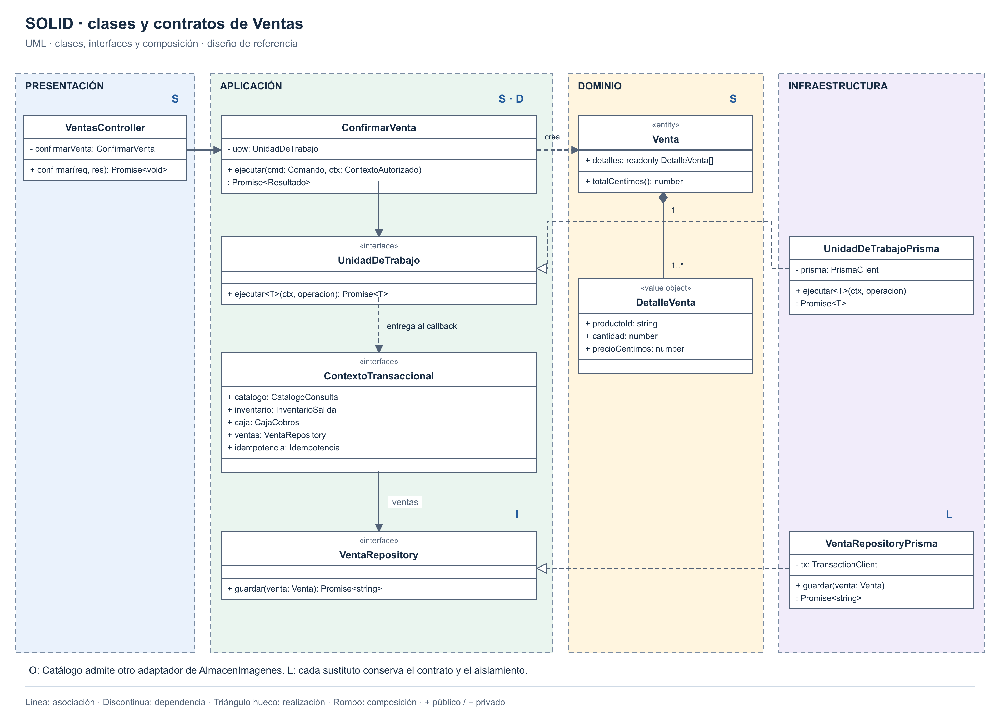

# Principios de diseño (SOLID)

## Objetivo

Organizar el backend para que las reglas de negocio permanezcan independientes de HTTP y persistencia.

## Contexto

- **Estilo:** monolito modular con Node.js, Express y TypeScript.
- **Enfoque:** Clean Architecture.
- **Referencia:** Ventas; Adapter de imágenes en Catálogo.

## Aplicación de SOLID

| Principio | Capa | Cómo se aplica | Archivos previstos |
|---|---|---|---|
| **S · Responsabilidad única** | Todas | Controlador: HTTP; caso de uso: coordinación; Venta: reglas; repositorio: persistencia. | `ventas.controller.ts`, `confirmar-venta.ts`, `venta.ts`, `venta-repository-prisma.ts` |
| **O · Abierto/cerrado** | Infraestructura | Otro almacén de imágenes implementa el mismo puerto sin cambiar el caso de uso. | `almacen-imagenes.ts`, `almacen-imagenes-r2.ts` |
| **L · Sustitución de Liskov** | Infraestructura | Los adaptadores conservan resultados, errores y aislamiento del contrato; la unidad de trabajo mantiene todo o nada. | `venta-repository-prisma.ts`, `unidad-de-trabajo-prisma.ts` |
| **I · Segregación de interfaces** | Aplicación | Ventas usa puertos pequeños: cotizar, descontar, registrar cobros y guardar. | `catalogo-consulta.ts`, `inventario-salida.ts`, `caja-cobros.ts`, `venta-repository.ts` |
| **D · Inversión de dependencias** | Aplicación | `ConfirmarVenta` recibe `UnidadDeTrabajo`; no importa Prisma ni Express. | `confirmar-venta.ts`, `unidad-de-trabajo.ts`, `ventas.module.ts` |

## Situaciones concretas

| Cambio | Sin separación | Con el diseño |
|---|---|---|
| Cambiar una regla de cantidades | Buscarla en rutas y consultas. | Modificar `Venta` y sus pruebas. |
| Cambiar la respuesta HTTP | Arriesgar cambios en reglas. | Modificar el controlador. |
| Cambiar el proveedor de fotos | Modificar el caso de uso. | Implementar y conectar otro adaptador. |
| Probar el total | Depender del servidor y la base. | Probar `Venta` directamente. |

## Relación con la arquitectura

| Elemento | Principios que ayuda a aplicar |
|---|---|
| Capas y responsabilidades delimitadas | S |
| Puertos pequeños y adaptadores con contratos verificables | O, L, I |
| Repository e inyección de dependencias | D |

- Las pruebas de contrato verifican la sustitución de adaptadores.
- Las pruebas con PostgreSQL verifican transacciones y aislamiento.
