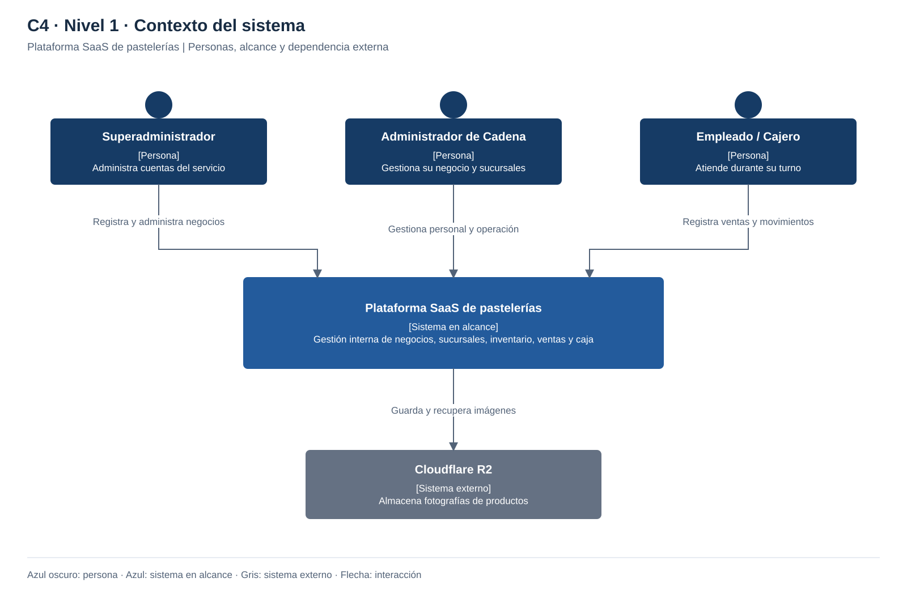

# Nivel 1 · Diagrama de contexto del sistema

> **Proyecto:** Plataforma SaaS de pastelerías  
> **Estado:** Diseño propuesto; pendiente de implementación.

## 1. Objetivo

Mostrar quién utiliza la plataforma y con qué sistema externo se comunica.

| Aspecto | Descripción |
|---|---|
| Pregunta que responde | ¿Qué es el sistema, quién lo utiliza y con quién se integra? |
| Audiencia | Negocio, docente y equipo de desarrollo |
| Qué no muestra | Tecnologías, base de datos ni módulos internos |
| Siguiente nivel | [Nivel 2](Nivel2-DiagramadeContenedores.md) |

## 2. Diagrama

## 3. Personas (usuarios)

| Persona | Descripción | Qué hace en el sistema |
|---|---|---|
| **Superadministrador** | Responsable del servicio SaaS | Registra negocios, asigna administradores y configura límites. |
| **Administrador de Cadena** | Dueño o responsable del negocio | Gestiona sucursales, personal, turnos, permisos, productos y resultados. |
| **Empleado / Cajero** | Personal asignado a un local y turno | Atiende, cobra y opera caja e inventario según sus permisos. |

## 4. Sistemas

| Sistema | Tipo | Responsabilidad | Quién lo construye |
|---|---|---|---|
| **Plataforma SaaS de pastelerías** | Sistema en alcance | Controlar la operación de varios negocios con información aislada. | Equipo del proyecto |
| **Cloudflare R2** | Sistema externo de apoyo | Almacenar y proporcionar las fotografías solicitadas por la plataforma. | Proveedor externo |

- Alcance: gestión interna.
- Integración externa: fotografías en R2.

## 5. Relaciones

| Origen | Destino | Descripción | Protocolo |
|---|---|---|---|
| Superadministrador | Plataforma | Administra cuentas de negocio. | — |
| Administrador de Cadena | Plataforma | Gestiona su negocio y sus sucursales. | — |
| Empleado / Cajero | Plataforma | Registra ventas y movimientos de caja e inventario según sus permisos. | — |
| Plataforma | Cloudflare R2 | Guarda y recupera fotografías con acceso autorizado. | HTTPS |

## 6. Decisiones y supuestos

| # | Decisión o supuesto | Motivo |
|---|---|---|
| 1 | Un negocio representa un tenant y puede tener una o varias sucursales. | Usar el mismo modelo para un local pequeño y una cadena. |
| 2 | Un empleado puede estar asignado a varios locales del mismo negocio. | Evitar duplicar su identidad al cambiar de sucursal. |
| 3 | El superadministrador no accede a operaciones de todos los negocios por defecto. | Separar administración de plataforma de acceso operativo. |