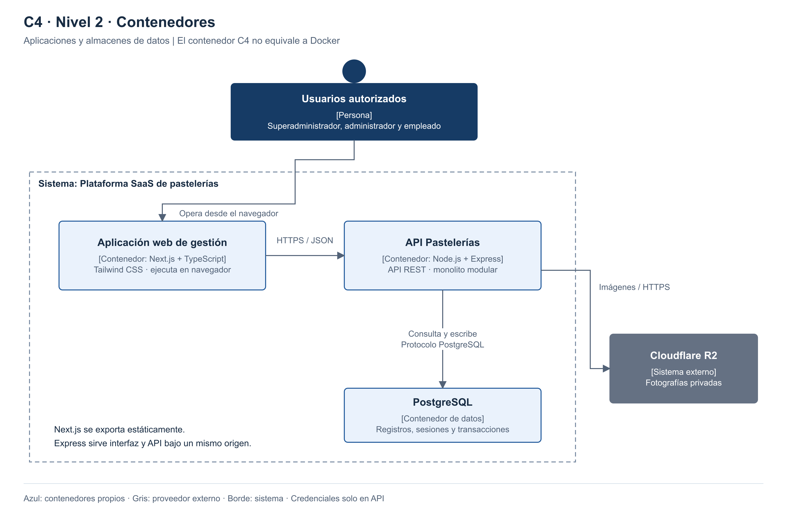

# Nivel 2 · Diagrama de contenedores

> **Proyecto:** Plataforma SaaS de pastelerías  
> **Estado:** Diseño propuesto; pendiente de implementación.

## 1. Objetivo

Mostrar las aplicaciones y almacenes de datos de la plataforma.

| Aspecto | Descripción |
|---|---|
| Pregunta que responde | ¿Qué aplicaciones y almacenes forman el sistema? |
| Audiencia | Arquitectos, desarrolladores y operaciones |
| Qué es un contenedor | Aplicación o almacén de datos; no necesariamente un contenedor Docker. |
| Nivel anterior | [Nivel 1](Nivel1-DiagramadeContextodelSistema.md) |
| Siguiente nivel | [Nivel 3](Nivel3-Diagrama-de-Componentes.md) |

## 2. Diagrama

## 3. Contenedores

| Contenedor | Tecnología | Responsabilidad | Datos que maneja |
|---|---|---|---|
| **Aplicación web** | Next.js, TypeScript y Tailwind CSS | Interfaz de atención y administración en navegador. | Estado temporal de pantalla y carrito. |
| **API Pastelerías** | Express y TypeScript | Autorizar solicitudes y coordinar casos de uso. | Opera sobre la base mediante adaptadores Prisma. |
| **Base de datos** | PostgreSQL | Persistencia, transacciones y políticas de aislamiento. | Negocios, usuarios, turnos de trabajo, productos, stock, ventas, sesiones de caja y sesiones de acceso. |

Sistema externo relacionado:

| Sistema externo | Tecnología | Responsabilidad | Datos que maneja |
|---|---|---|---|
| **Cloudflare R2** | Cloudflare R2 (API compatible con S3) | Guardar fotografías mediante acceso autorizado. | Archivos de productos. |

## 4. Relaciones

| Origen | Destino | Descripción | Protocolo |
|---|---|---|---|
| Usuarios | Aplicación web | Utilizan la interfaz. | HTTPS |
| Aplicación web | API Pastelerías | Solicita operaciones y consultas. | HTTPS/JSON |
| API Pastelerías | PostgreSQL | Consulta y modifica información. | Protocolo PostgreSQL en red protegida |
| API Pastelerías | Almacenamiento de imágenes | Guarda y recupera fotografías autorizadas. | HTTPS |

## 5. Decisiones arquitectónicas reflejadas

| Decisión | Alternativa descartada | Motivo |
|---|---|---|
| Monolito modular | Microservicios iniciales | Mantener transacciones locales y una operación sencilla. |
| Next.js + Tailwind y Express + TypeScript | Backend duplicado en Next.js y Express | Mantener una sola API con las reglas; interfaz exportable y componentes reutilizables. |
| PostgreSQL | Base documental inicial | El modelo requiere relaciones, restricciones y transacciones. |
| Sin caché ni réplica inicial | Redis y réplica obligatorios | Medir consultas e índices antes de añadir componentes. |
| Una instancia y base administrada | Infraestructura redundante inicial | Propuesta de piloto ajustable a presupuesto; no constituye alta disponibilidad. |

- Next.js: exportación estática; Express sirve interfaz y API bajo el mismo origen.
- Datos privados: consultas en ejecución a `/api/v1`.
- Despliegue previsto: Render y PostgreSQL administrado; fotografías en R2.
- Sesiones en base de datos; archivos en R2; copias y restauración antes del piloto.

## 6. Seguridad entre contenedores

| Comunicación | Medida |
|---|---|
| Navegador → API | HTTPS, sesión revocable, cookie HttpOnly/Secure y protección CSRF. |
| API → PostgreSQL | Credenciales operativas sin privilegios administrativos, contexto tenant por transacción y políticas de filas. |
| API → Archivos | Credenciales solo en servidor; validación de formato, tamaño y negocio autorizado. |

- Contraseñas: Argon2id. Secretos fuera de Git; migraciones con rol separado.
